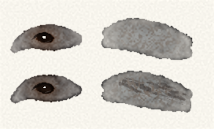
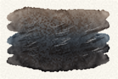

# Animal portraits

This wildlife portrait study shows a European badger lifting its muzzle to scent the air. The example applies to fur-bearing mammals. Take eye placement, coat growth and the shape of the muzzle from the species and individual in front of you. [Finished badger portrait](figures/european-badger-portrait.png)

## Pose and weight

Give the animal something observable to do. In the badger, the muzzle lifts towards open paper while the broad shoulder runs out of the lower left of the sheet. The dark beneath the jaw joins the chest. Reduce the picture until the hairs disappear. If the head seems to float, check where the cheek overlaps the shoulder and where the underside of the neck meets the chest.

For an original composition, choose one photograph for the head turn and the light. Measure both eye openings, ear bases and nostrils in that view. Use other photographs to answer questions the first leaves open. Here the Drenthe view supplied the facial proportions, the Scottish view showed the ear fringe and shoulder hairs, and the Surrey view clarified the warm colour breaking through the grey coat. [Charles J. Sharp, Drenthe](https://commons.wikimedia.org/wiki/File:European_badger_%28Meles_meles_taxus%29_Drenthe.jpg) · [Caroline Legg, Scotland](https://commons.wikimedia.org/wiki/File:European_Badger_-_Meles_meles_-_Scotland_%2853260881618%29.jpg) · [Chris Parfitt, Surrey](https://commons.wikimedia.org/wiki/File:Badger_25-07-09_closer.jpg)

## A small eye inside a dark facial marking

Measure the visible lid opening against the muzzle before placing the pupil. On the badger the near eye shows a warm lower rim beneath the dark upper lid. The head turn narrows the far eye. Those two silhouettes already give the animal a direction of attention. Paint only as much of the white of the eye as the pose reveals.

On cold press, two short `mask` strokes with radii of 1.8 and 1.2 pixels both left a centre at about 0.96 on a value scale from black at 0 to white at 1. The smaller mark looked quieter at the same brightness. I used that difference for the far eye in the portrait. Try both reserves at the intended eye size, paint the lids and pupil, then dry and `unmask`. Judge the glints at normal viewing distance. The trial follows Jo Allsopp's practice of reserving the light when first wetting the eye. [Jo Allsopp's badger demonstration](https://www.artistsandillustrators.co.uk/how-to/how-to-paint-a-badger-in-watercolour)

## Undercoat, guard hairs and whiskers

Change the length and direction of the stroke where the coat grows differently. On the shoulder, long hairs follow the turn of the back. Across the cheek they sweep back from the muzzle, then shorten around the eye and whisker pads. Try a few strokes into a wet middle-value wash and a few over a dry one. On the trial sheet the wet marks sank into the undercoat. On dry paper each taper remained legible. [Carrie McKenzie's fox fur demonstration](https://www.skillshare.com/en/classes/wildlife-animal-and-landscape-painting-in-watercolour-fox-and-robin/1865526814)

On the second sheet a split `comber` grouped the dark strands. Over the dried wash a fine `round` with `opaque_white` at 1.4 gave a quiet strand, while 3.7 left a visible silver tip. On selected badger guard hairs, paint the pale shaft and tip separately so the short dark band shows between them. Check for banding in the animal you are painting. [Mammal Society description of the badger's coat](https://mammal.org.uk/british-mammals/badger)

Keep the brightest nose reflections short and broken so they follow the pebbled skin. Start whiskers at the turn of the muzzle pad, vary their arcs and taper them into the paper. On another sheet I would join the two large flank washes while their edges were wetter. Once dry, that seam competed with the guard hairs, even after individual strands crossed it.
