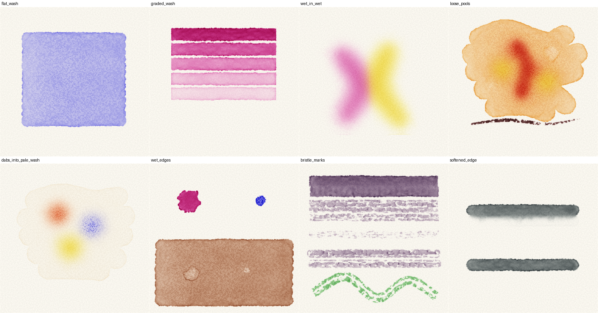
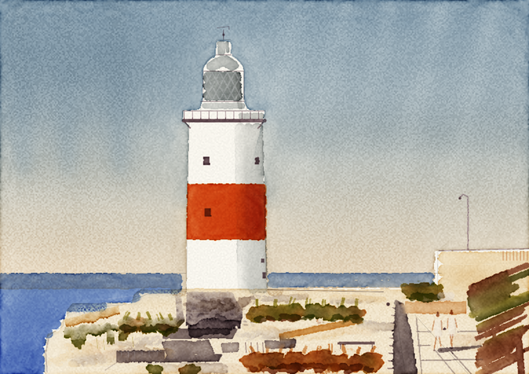

# watercolour

A watercolour painting harness. It simulates a sheet of paper, water, pigment and brushes, and is driven one stroke at a time through a command-line interface. There is no undo: what reaches the sheet stays there, as on real paper. Every painting is recorded as a time-lapse video.

It was built so that a language model can be given a brief, paint it, look at what it has done, and be judged on the result across many paintings.



## Requirements

- Python 3.13 and [uv](https://docs.astral.sh/uv/)
- PyTorch (installed by `uv sync`); a CUDA graphics card is used when present and makes painting several times faster
- `ffmpeg` on the path, for the time-lapse

```bash
uv sync
```

## Painting

A painting lives in a directory. It is started once, painted in passes, looked at as often as wanted, and finished once.

```bash
uv run watercolor new paintings/first --prompt "A tree on a hill at dusk" --size 512 --height 360
```

```bash
uv run watercolor paint paintings/first actions.json
```

```bash
uv run watercolor look paintings/first --view wetness --grid
```

```bash
uv run watercolor finish paintings/first
```

A pass is a JSON list of actions carried out in order:

```json
[
  {"action": "load", "brush": "mop", "size": 22, "pigments": {"cobalt_blue": 0.5}, "water": 1.0},
  {"action": "stroke", "path": [[0, 40, 0.9], [512, 40, 0.9]], "speed": 280},
  {"action": "wait", "seconds": 60},
  {"action": "load", "brush": "round", "size": 8, "pigments": {"burnt_sienna": 2.0}, "water": 0.9},
  {"action": "stroke", "path": [[120, 200, 0.4], [160, 180, 1.0], [210, 205, 0.5]], "smooth": true}
]
```

| Action | Fields |
|---|---|
| `load` | `brush` (one of 19 shapes of head, such as `round`, `flat`, `mop`, `rigger`, `filbert`, `dagger`), `hair` (optional, one of 9, such as `kolinsky_sable`, `squirrel`, `golden_synthetic`), `size` (radius in pixels, 0.5 to 80), `pigments` (name to strength, totalling at most 8), `water` (0 to 1), `rinse` |
| `stroke` | `path` of points, each `[x, y]`, `[x, y, pressure]`, or a mapping with `x`, `y` and any of `pressure`, `angle` (0 upright to 90 laid flat), `twist` (the edge of a flat head, -90 to 90 degrees) and `t` (seconds); `speed` in pixels per second when no times are given; `smooth`; `dwell` in seconds for a single-point dab |
| `blot` | `path`, `radius` |
| `pencil`, `erase` | `path`; the underdrawing can change only until paint touches the sheet |
| `wait` | `seconds` |
| `dry` | wait until the sheet is dry |
| `tilt` | `x`, `y` (up to 0.3); paint runs downhill |

`look` saves a picture of the sheet as it is now: in colour, as values only, or as a wetness map showing where the paper is shiny, moist, damp or dry. Looking changes nothing.

### Rules the harness enforces

- **No undo.** There is no command that previews, rehearses or reverses an action.
- **A tamper-evident record.** Every action is appended to a hash-chained log, and each pass records a digest of the saved state. A state file that does not follow from the log is refused.
- **A stroke budget**, a restricted palette, an optional scrap sheet, and an optional pencil underdrawing, all fixed when the painting is started.
- **Time passes.** A stroke takes time to make, and paint laid earlier keeps flowing and drying while later strokes are made.

## The engine

The model follows Curtis et al., "Computer-Generated Watercolor" (1997): surface water carrying suspended pigment, pigment deposited on the paper, and water held within the paper. Surface flow is a thin-film equation.

- **Water and pigment are separate.** Pigment is carried by the water, diffuses through it, settles and can be lifted again.
- **Wet edges** hold on dry paper until the water behind them is deep enough, and advance unevenly because the paper's sizing is uneven.
- **Drying** carries pigment to the edge of a wash, which dries darker than its middle; water dropped into a damp wash leaves a bloom.
- **Paper** has grain, broad undulation, uneven sizing and limited absorbency.
- **Brushes** hold a finite load of paint, run dry, part into streaks, push wet paint the way they travel, and take paint back up. Each load differs slightly from the last.
- **A stroke is a journey.** Every point can set pressure, the angle of the brush to the paper and the twist of a flat head, and can be given a time, so the brush can land on its point, press into its belly, turn its edge, pause and flick away.
- **A brush is a shape, a hair and a size.** Nineteen shapes of head (round, flat, slanted and rounded, from spotter to hake) and nine hairs (sables, squirrel, goat, badger and synthetics) set how much it holds, how fine a point it takes, how it ends a stroke and how soon it runs dry. See [docs/brushes.md](docs/brushes.md).
- **Paint** is a mixture: strong paint leaves less room for water and catches on the grain.
- **Colour** is rendered with Kubelka-Munk mixing over the paper, so glazes darken and opaque white covers.

Sheets of the same size can be advanced together on one graphics card (`watercolor.together`), which is how the trials run.

## Trials and tests

```bash
uv run python trials/engine_trials.py
```

paints each technique on its own sheet and writes the pictures to `trials/output/`. Name trials on the command line to run only those.

```bash
uv run pytest
```

runs the physical invariants (conservation of pigment and water, stable drying, and each fault found during development) and the session rules. They take about two minutes on a graphics card.

```bash
uv run ruff check . && uv run ruff format --check . && uv run pyrefly check
```

## Lighthouse study



`trials/lighthouse_painting.py` paints this through a session. It is a study after **Michele Clamp's** lighthouse watercolour, following the order of work in her [lighthouse watercolour tutorial](https://micheleclamp.com/lighthouse-watercolor-tutorial/). The composition is hers; the positions of its shapes were measured from her painting. Her original is the better picture, and worth looking at beside this one.

```bash
uv run python trials/lighthouse_painting.py paintings/lighthouse
```

## Known limits

- Pigment optical values for most paints are recalled from the Curtis paper and have not been checked against it; the rest are estimated from the colour of the paint.
- Flow strengths, drying times and brush drag are set by eye, not calibrated against filmed painting.
- There is no spatter tool.
- A painting of about 770 by 540 pixels takes seven to nine minutes on an RTX 3080.
- The package and command are spelled `watercolor`; the repository is `watercolour`.

## Licence

MIT. See [LICENSE](LICENSE).
