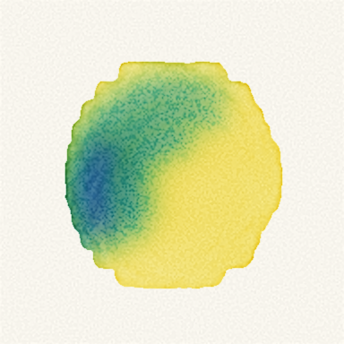
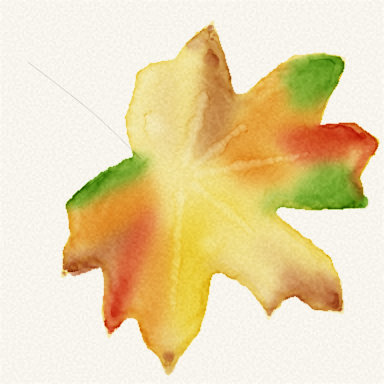
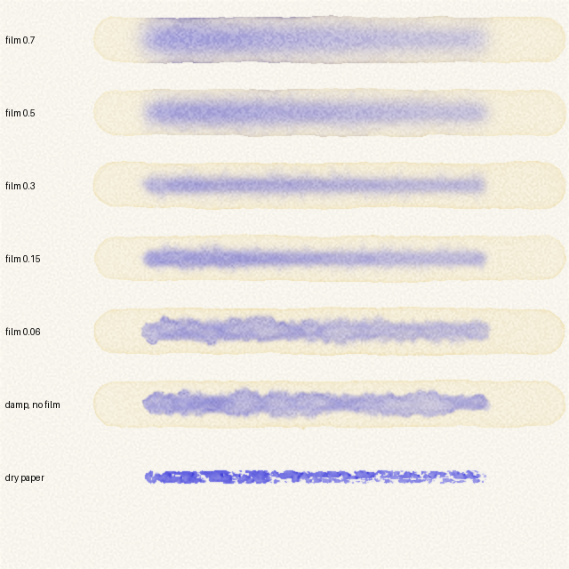
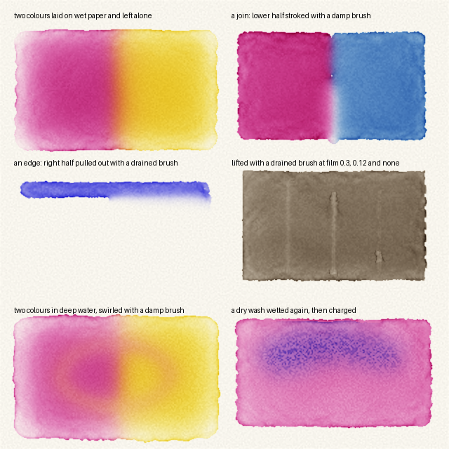

# watercolour

A watercolour painting harness. It simulates a sheet of paper, water, pigment and brushes, and is driven one stroke at a time through a command-line interface. There is no undo: what reaches the sheet stays there, as on real paper. Every painting is recorded as a time-lapse video.

It was built so that a language model can be given a brief, paint it, look at what it has done, and be judged on the result across many paintings.


## Install

You need Linux or macOS, Python 3.13 or newer, [uv](https://docs.astral.sh/uv/), and `ffmpeg` on the path for the time-lapse. PyTorch is installed with the package and is a download of several gigabytes the first time. A CUDA graphics card is used when present and makes painting several times faster.

**To paint with it,** install the `watercolor` command for your user. It then works from any directory:

```bash
uv tool install git+https://github.com/timbrinded/watercolour
```

To try it once without installing anything:

```bash
uvx --from git+https://github.com/timbrinded/watercolour watercolor --help
```

**To work on it,** or to run the trials, the tests and the lighthouse study, clone the repository:

```bash
git clone https://github.com/timbrinded/watercolour && cd watercolour && uv sync
```

Inside a clone, put `uv run` before each command (`uv run watercolor ...`). The package is not on PyPI; install it from this repository.

**To teach a model to paint with it,** install the skill in [.claude/skills/paint-watercolour](.claude/skills/paint-watercolour) for your user. This needs Node.js:

```bash
npx -y skills add https://github.com/timbrinded/watercolour -g -y
```

Inside a clone the skill is found automatically and needs no installing. The skill teaches the painting; the `watercolor` command above must be installed as well.

## Painting

A painting lives in a directory. It is started once, painted in passes, looked at as often as wanted, and finished once.

```bash
watercolor new paintings/first --prompt "A tree on a hill at dusk" --size 512 --height 360
```

```bash
watercolor paint paintings/first actions.json
```

```bash
watercolor look paintings/first --view wetness --grid
```

```bash
watercolor finish paintings/first
```

A pass is a JSON list of actions carried out in order:

```json
[
  {"action": "load", "brush": "mop", "size": 22, "pigments": {"cobalt_blue": 0.5}, "water": 1.0},
  {"action": "stroke", "path": [[0, 40, 0.9], [512, 40, 0.9]], "speed": 280},
  {"action": "wait", "seconds": 60},
  {"action": "load", "brush": "round", "size": 8, "pigments": {"burnt_sienna": 2.0}, "water": 0.9},
  {"action": "stroke", "path": [[120, 200, 0.4], [160, 180, 1.0], [210, 205, 0.5]], "smooth": true}
]
```

| Action | Fields |
|---|---|
| `load` | `brush` (one of 19 shapes of head, such as `round`, `flat`, `mop`, `rigger`, `filbert`, `dagger`), `hair` (optional, one of 9, such as `kolinsky_sable`, `squirrel`, `golden_synthetic`), `size` (radius in pixels, 0.5 to 80), `pigments` (name to strength, totalling at most 8), `water` (0 to 1), `rinse` |
| `drain` | `water` (0 to 1): touch the brush to a cloth until it holds no more than this share of what it can; it keeps its colour and loses only fullness |
| `stroke` | `path` of points, each `[x, y]`, `[x, y, pressure]`, or a mapping with `x`, `y` and any of `pressure`, `angle` (0 upright to 90 laid flat), `twist` (the edge of a flat head, -90 to 90 degrees) and `t` (seconds); `speed` in pixels per second when no times are given; `smooth`; `dwell` in seconds for a single-point dab |
| `blot` | `path`, `radius` |
| `pencil`, `erase` | `path`; the underdrawing can change only until paint touches the sheet |
| `wait` | `seconds`; with `at` (a point) and `film` (a depth) the wait ends as soon as the film of water there has thinned to that depth |
| `dry` | wait until the sheet is dry |
| `tilt` | `x`, `y` (up to 0.3); paint runs downhill |

`look` saves a picture of the sheet as it is now: in colour, as values only, or as a wetness map. Looking changes nothing.

Wetness is two continuous scales, not a set of states: the depth of the film of water standing on the surface, and how full of water the paper is. The wetness map shows both with a scale beneath it, `look --at x,y` reads them as numbers at a point, and `status` gives the film at its deepest and at its usual depth.

```bash
watercolor look paintings/first --view wetness --at 240,180 --at 400,300
```

### When a command is cut short

The painting is saved as each action ends and every few seconds through a long wait. A `paint` or `finish` that is killed part-way, by a tool's timeout for instance, loses only the action it was in the middle of, and the painting stays usable. `status` reports how far the pass got under `interrupted_pass`. The same `paint` command given again carries on from where it stopped, without repeating the actions already on the sheet; a pass that differs in any way starts from its first action.

### Rules the harness enforces

- **No undo.** There is no command that previews, rehearses or reverses an action.
- **A tamper-evident record.** Every action is appended to a hash-chained log with a digest of the state saved after it. A state file that does not follow from the log is refused.
- **One command at a time.** A second command on a painting is refused until the first ends.
- **A stroke budget**, a restricted palette, an optional scrap sheet, and an optional pencil underdrawing, all fixed when the painting is started.
- **Time passes.** A stroke takes time to make, and paint laid earlier keeps flowing and drying while later strokes are made.

## The engine

The model follows Curtis et al., "Computer-Generated Watercolor" (1997): surface water carrying suspended pigment, pigment deposited on the paper, and water held within the paper. Surface flow is a thin-film equation.

- **Water and pigment are separate.** Pigment is carried by the water, diffuses through it, settles and can be lifted again.
- **Wet edges** hold on dry paper until the water behind them is deep enough, and advance unevenly because the paper's sizing is uneven.
- **Drying** carries pigment to the edge of a wash, which dries darker than its middle; water dropped into a damp wash leaves a bloom.
- **Paper** has grain, broad undulation, uneven sizing and limited absorbency.
- **Brushes** hold a finite load of paint, run dry, part into streaks, push wet paint the way they travel, and take paint back up. Each load differs slightly from the last.
- **How full the brush is decides what it does to wet paint.** A full brush floods; a damp one carries wet paint on its tip and gives it back further along, so it draws one colour into the next, pulls out an edge and stirs colours together in standing water; a drained one draws up what it loosens and lifts paint from a wash.
- **Granulating paints gather in the hollows of the grain under deep water**, in suspension and after they have settled, so a granulating colour charged into a deep wash dries as fine specks that thin out toward its front. In the film of an ordinary wash they stay where they settle.
- **A stroke is a journey.** Every point can set pressure, the angle of the brush to the paper and the twist of a flat head, and can be given a time, so the brush can land on its point, press into its belly, turn its edge, pause and flick away.
- **A brush is a shape, a hair and a size.** Nineteen shapes of head (round, flat, slanted and rounded, from spotter to hake) and nine hairs (sables, squirrel, goat, badger and synthetics) set how much it holds, how fine a point it takes, how it ends a stroke and how soon it runs dry. See [docs/brushes.md](docs/brushes.md).
- **Paint** is a mixture: strong paint leaves less room for water and catches on the grain.
- **Colour** is rendered with Kubelka-Munk mixing over the paper, so glazes darken and opaque white covers.

Sheets of the same size can be advanced together on one graphics card (`watercolor.together`), which is how the trials run.

## Wet in wet

 

Both are engine trials (`charged_wash` and `variegated_leaf`). On the left, strong blue paint on a brush drained to about 0.6 is touched into a deep yellow wash and left alone. On the right, a leaf is laid in a pale wash, each colour is laid over its own part of it so that colour meets colour, stronger touches follow as the film thins, and the veins are lifted with a drained brush once it has nearly gone.



How far a charge spreads, how soft its edge is and whether it blooms all follow from the depth of the film when the brush lands.



The method for each of these is written up for a painting model in [the skill's wet-in-wet reference](.claude/skills/paint-watercolour/references/wet-in-wet.md).

## Trials and tests

These need a clone of the repository.

```bash
uv run python trials/engine_trials.py
```

paints each technique on its own sheet and writes the pictures to `trials/output/`. Name trials on the command line to run only those; all of them together take about half an hour.

```bash
uv run pytest
```

runs the physical invariants (conservation of pigment and water, stable drying, and each fault found during development) and the session rules. They take about three minutes on a graphics card.

```bash
uv run ruff check . && uv run ruff format --check . && uv run pyrefly check
```

## Lighthouse study


`trials/lighthouse_painting.py` paints this through a session. It is a study after **Michele Clamp's** lighthouse watercolour, following the order of work in her [lighthouse watercolour tutorial](https://micheleclamp.com/lighthouse-watercolor-tutorial/). The composition is hers; the positions of its shapes were measured from her painting. Her original is the better picture, and worth looking at beside this one.

```bash
uv run python trials/lighthouse_painting.py paintings/lighthouse
```

## Known limits

- Pigment optical values for most paints are recalled from the Curtis paper and have not been checked against it; the rest are estimated from the colour of the paint.
- Flow strengths, drying times, brush drag and granulation are set by eye, not calibrated against filmed painting. Depths of film and the fullness of the brush are in the engine's own units.
- Wet-in-wet blends come out more even in width and in value than a painter's. A granulating paint dries as dark dots of one size, where real paint clumps at several scales and leaves pale flecks of paper inside dense colour. Reviewers comparing the two wet-in-wet trials with real paintings of the same effects rated them mostly, not fully, alike.
- There is no spatter tool.
- A painting of about 770 by 540 pixels takes seven to nine minutes on an RTX 3080.
- The package and command are spelled `watercolor`; the repository is `watercolour`.

## Licence

MIT. See [LICENSE](LICENSE).
