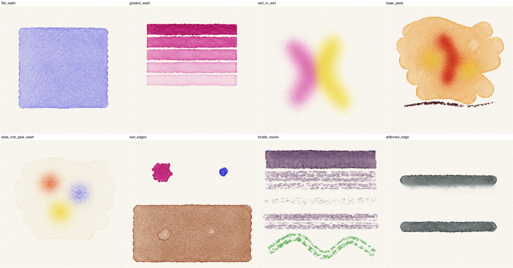
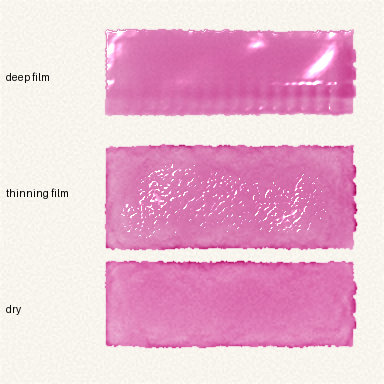
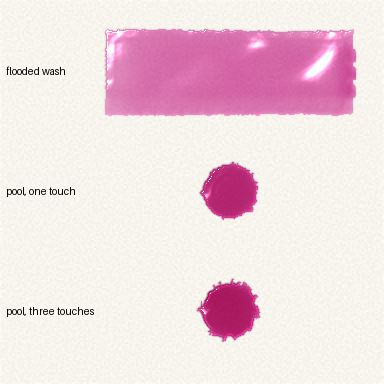
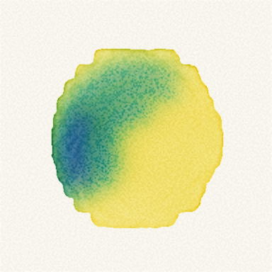
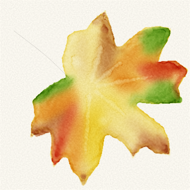
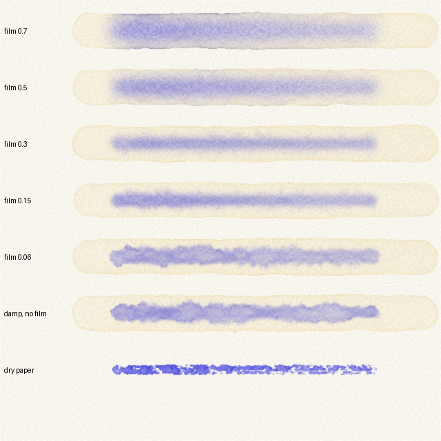
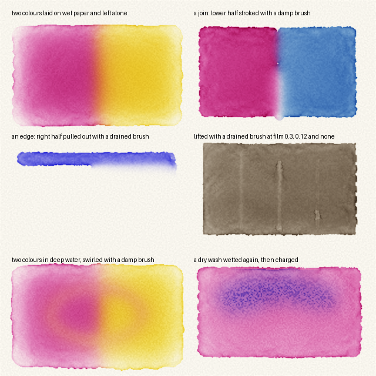
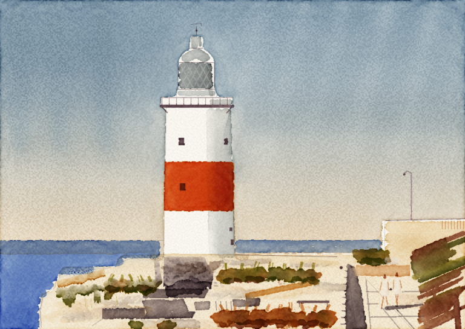

# watercolour

A watercolour painting harness. It simulates a sheet of paper, water, pigment and brushes, and is driven one stroke at a time through a command-line interface. There is no undo: what reaches the sheet stays there, as on real paper. Every painting is recorded as a time-lapse video.

It was built so that a language model can be given a brief, paint it, look at what it has done, and be judged on the result across many paintings.



## Install

You need Linux or macOS, Python 3.13 or newer, [uv](https://docs.astral.sh/uv/), and `ffmpeg` on the path for the time-lapse. PyTorch is installed with the package and is a download of several gigabytes the first time. A CUDA graphics card is used when present and makes painting several times faster.

**To paint with it,** install the `watercolor` command for your user. It then works from any directory:

```bash
uv tool install git+https://github.com/timbrinded/watercolour
```

That installs the newest commit on `main`. To install a release, name its tag, for example `git+https://github.com/timbrinded/watercolour@v0.10.0`. Each [release](https://github.com/timbrinded/watercolour/releases) lists what changed since the one before and carries a wheel and a source archive.

To try it once without installing anything:

```bash
uvx --from git+https://github.com/timbrinded/watercolour watercolor --help
```

**To work on it,** or to run the trials, the tests and the lighthouse study, clone the repository:

```bash
git clone https://github.com/timbrinded/watercolour && cd watercolour && uv sync
```

Inside a clone, put `uv run` before each command (`uv run watercolor ...`). The package is not on PyPI; install it from this repository.

**To teach a model to paint with it,** install the skill in [.claude/skills/paint-watercolour](.claude/skills/paint-watercolour) for your user. This needs Node.js:

```bash
npx -y skills add https://github.com/timbrinded/watercolour -g -y
```

Inside a clone the skill is found automatically and needs no installing. The skill teaches the painting; the `watercolor` command above must be installed as well.

## Painting

A painting lives in a directory. It is started once, painted in passes, looked at as often as wanted, and finished once.

```bash
watercolor new paintings/first --prompt "A tree on a hill at dusk" --size 512 --height 360
```

Without `--palette` a painting has thirteen paints. Eight more are on a painting only when `--palette` names them: `phthalo_blue`, `phthalo_turquoise` and `dioxazine_violet` (transparent and staining), `viridian` (a green that lifts), `fluorescent_pink` and `fluorescent_yellow` (neon colour), and the pen's inks `carbon_ink` and `soluble_ink`.

The sheet is cold-press paper unless `--support hot_press` or `--support rough` is given, and `--ground <image>` prints an image on it before any paint. The skill's [actions reference](.claude/skills/paint-watercolour/references/actions.md) lists every option of `new`.

```bash
watercolor paint paintings/first actions.json
```

```bash
watercolor look paintings/first --view wetness --grid
```

```bash
watercolor finish paintings/first
```

A pass is a JSON list of actions carried out in order:

```json
[
  {"action": "load", "brush": "mop", "size": 22, "pigments": {"cobalt_blue": 0.5}, "water": 1.0},
  {"action": "stroke", "path": [[0, 40, 0.9], [512, 40, 0.9]], "speed": 280},
  {"action": "wait", "seconds": 60},
  {"action": "load", "brush": "round", "size": 8, "pigments": {"burnt_sienna": 2.0}, "water": 0.9},
  {"action": "stroke", "path": [[120, 200, 0.4], [160, 180, 1.0], [210, 205, 0.5]], "smooth": true}
]
```

| Action | Fields |
|---|---|
| `load` | `brush` (one of 19 shapes of head, such as `round`, `flat`, `mop`, `rigger`, `filbert`, `dagger`), `hair` (optional, one of 9, such as `kolinsky_sable`, `squirrel`, `golden_synthetic`), `size` (radius in pixels, 0.5 to 80), `pigments` (name to strength, totalling at most 8), `water` (0 to 1), `rinse` |
| `drain` | `water` (0 to 1): touch the brush to a cloth until it holds no more than this share of what it can; it keeps its colour and loses only fullness |
| `stroke` | `path` of points, each `[x, y]`, `[x, y, pressure]`, or a mapping with `x`, `y` and any of `pressure`, `angle` (0 upright to 90 laid flat), `twist` (the edge of a flat head, -90 to 90 degrees) and `t` (seconds); `speed` in pixels per second when no times are given; `smooth`; `dwell` in seconds for a single-point dab |
| `blot` | `path`, `radius` |
| `pencil` | `path` of `[x, y]` or `[x, y, pressure]` points, `darkness` (at most 2.5), `radius` (0.5 to 10), `smooth`: a graphite line, narrowing and fading where the pencil lifts, building tone where lines cross. It is the underdrawing, refused once paint touches the painting, unless the painting was started with `--pencil-after-paint`: then pencil drawn on dried paint lies on it, under any paint laid later |
| `erase` | `path`, `radius`: rub pencil off bare paper; pencil under or on paint is out of reach. Refused once paint touches the painting |
| `wait` | `seconds`; with `at` (a point) and `film` (a depth) the wait ends as soon as the film of water there has thinned to that depth |
| `dry` | wait until the sheet is dry |
| `tilt` | `x`, `y` (up to 0.3); paint runs downhill |
| `mask` | `path` of `[x, y]` or `[x, y, pressure]` points, `radius` (0.5 to 40, the width at full pressure; a point with no pressure is laid at full pressure, and lifting narrows the line to 0.15 of it, so one stroke can taper like a brush), `smooth`: lay masking fluid. It seals the paper (no water crosses into it, so a wash meets it as a wall and dries with a crisp, darker edge), it protects any paint already under it, and paint landing on it stands on the rubber. It forms only where no film of water stands; laid into wet paint it seals nothing |
| `unmask` | optional `path` and `radius` together: rub the masking fluid away, all of it or along a path. Paint dried on it comes away with it; paint still wet on it is smeared onto the paper |
| `pen` | `path` of `[x, y]` or `[x, y, pressure]` points, `width` (0.25 to 8, the full width at full pressure; lifting narrows the line to 0.15 of it), `ink` (palette paints to the amount laid on each pixel, at most 8 in all), `speed`, `smooth`: draw a line in ink. It lays the same ink from the start of the line to its end, and never draws narrower than one pixel. On dry paper the line keeps a crisp edge and the pixels beside it stay paper; on wet paper it spreads into the water. It needs no brush. The paints `carbon_ink`, which barely lifts once dry, and `soluble_ink`, which water takes back up, are chosen with `--palette` |
| `fix` | optional `path` and `radius` (1 to 80) together: lay fixative, alum size or acrylic medium, over the whole sheet or along a path. Paint settled on the paper under it, before the fix or after, can no longer be lifted, rolled or scrubbed; wet paint on it flows as on bare paper. It is laid only where no film of water stands and not on masking fluid, cannot be seen and cannot be removed |
| `draw` | `medium` (`coloured_pencil` or `pastel`), `pigments` (palette paints to the stick's strength, at most 4 in all), `path` of `[x, y]` or `[x, y, pressure]` points, `radius` (0.5 to 20, the half-width at full pressure), `smooth`: a line with a dry stick. Light pressure marks only the peaks of the grain and full pressure fills it; pressure 0 lifts the stick, so one action can hatch a whole patch. The mark lies over the paint and earlier marks and under paint laid later, so white pastel lights a dark; it takes only on dry paper and never on masking fluid, and no water moves it. Counts against the stroke budget |

`look` saves a picture of the sheet as it is now: in colour, as values only, or as a wetness map. Looking changes nothing.

Wetness is two continuous scales, not a set of states: the depth of the film of water standing on the surface, and how full of water the paper is. The wetness map shows both with a scale beneath it, `look --at x,y` reads them as numbers at a point, and `status` gives the film at its deepest and at its usual depth.

```bash
watercolor look paintings/first --view wetness --at 240,180 --at 400,300
```

The colour picture shows the water as well, as a camera straight above the sheet sees it with a small lamp beside it. Water mirrors the lamp only where its surface is tilted. A film deep enough to shine keeps its colour and shows a bright line along its rim and a soft highlight where the sheet buckles; a thinning film glitters in fine points over the grain; paper with no film on it shows nothing. The value and wetness views leave this light out, and a finished painting, being dry, has none.



Water that stands proud of the sheet, such as a pool dabbed onto dry paper, also bends the lamp's light as a lens. The paper under the shoulder of the pool is lit more than a dry sheet and the paper under its edge less, and the side away from the lamp is the brighter, so a pool looks raised where a wash looks flat. A wash lies too level for this: the paper under it is lit within a few parts in a hundred of a dry sheet. The value and wetness views leave this out as well.



### When a command is cut short

The painting is saved as each action ends and every few seconds through a long wait. A `paint` or `finish` that is killed part-way, by a tool's timeout for instance, loses only the action it was in the middle of, and the painting stays usable. `status` reports how far the pass got under `interrupted_pass`. The same `paint` command given again carries on from where it stopped, without repeating the actions already on the sheet; a pass that differs in any way starts from its first action.

### Rules the harness enforces

- **No undo.** There is no command that previews, rehearses or reverses an action.
- **A tamper-evident record.** Every action is appended to a hash-chained log with a digest of the state saved after it. A state file that does not follow from the log is refused.
- **One command at a time.** A second command on a painting is refused until the first ends.
- **A restricted palette**, an optional scrap sheet, optional pencil and dry media, whether pencil may follow paint, and an optional limit on strokes (`--stroke-budget`; there is none unless one is given), all fixed when the painting is started.
- **Time passes.** A stroke takes time to make, and paint laid earlier keeps flowing and drying while later strokes are made.

## The engine

The model follows Curtis et al., "Computer-Generated Watercolor" (1997): surface water carrying suspended pigment, pigment deposited on the paper, and water held within the paper. Surface flow is a thin-film equation whose mobility is the cube of the depth, as lubrication theory gives for a film on paper it does not slip on: a deep pool runs freely while a thin film barely moves.

- **Water and pigment are separate.** Pigment is carried by the water, diffuses through it, settles and can be lifted again, unless the paper under it has been fixed or it lies two layers down under covering paint.
- **Wet edges** hold on dry paper until the water behind them is deep enough, and advance unevenly because the paper's sizing is uneven.
- **Drying** carries pigment to the edge of a wash, which dries darker than its middle; water dropped into a damp wash leaves a bloom.
- **Paper** has grain, broad undulation, uneven sizing and limited absorbency. It is cold press unless the painting is begun on hot press, whose fine, shallow grain shows almost no speckle and which dries blooms and tide lines harder, or on rough, whose broad tops and deep pits hold water and coarse granulation. An image can be printed on the sheet before any paint; it lies under every layer.
- **Brushes** hold a finite load of paint, run dry, part into streaks, push wet paint the way they travel, and take paint back up. Each load differs slightly from the last.
- **How full the brush is decides what it does to wet paint.** A full brush floods; a damp one carries wet paint on its tip and gives it back further along, so it draws one colour into the next, pulls out an edge and stirs colours together in standing water; a drained one draws up what it loosens and lifts paint from a wash.
- **Granulating paints gather in the hollows of the grain under deep water**, in suspension and after they have settled, so a granulating colour charged into a deep wash dries as fine specks that thin out toward its front. In the film of an ordinary wash they stay where they settle.
- **A stroke is a journey.** Every point can set pressure, the angle of the brush to the paper and the twist of a flat head, and can be given a time, so the brush can land on its point, press into its belly, turn its edge, pause and flick away.
- **A brush is a shape, a hair and a size.** Nineteen shapes of head (round, flat, slanted and rounded, from spotter to hake) and nine hairs (sables, squirrel, goat, badger and synthetics) set how much it holds, how fine a point it takes, how it ends a stroke and how soon it runs dry. See [docs/brushes.md](docs/brushes.md).
- **Paint** is a mixture: strong paint leaves less room for water and catches on the grain.
- **Colour** is rendered with Kubelka-Munk mixing over the paper, so glazes darken and opaque white covers.
- **Paint laid on paint that has dried is a new layer over it.** Paint dries once no film stands on it and the paper is no fuller than damp. Water that stands on it again, clear or carrying paint, does not make it wet paint: it lies beneath whatever settles out of that water, so colour charged into clear water over a dried dark, or carried there by the water, lies over the dark. Covering paint (opaque white, the mineral blue and green, shell white) then hides what is beneath in proportion to its body, a dark drawn over a light stays dark, and transparent glazes look as they always have. The water of a new layer, clear or coloured, lifts from the dried layer under it as it lifts from paint on bare paper, so a broad covering coat over a dark that lifts easily takes up some of it. When a third layer begins, the two older ones are merged where that changes nothing visible (transparent glazes, the same paint again), so they stay liftable; under covering paint, where merging would change the colour, the oldest is kept only as its colour and can no longer be lifted. Paint laid into paint still wet from being laid mixes with it. Pencil drawn before the paint lies under it.
- **Dry media lie on top.** A coloured-pencil or pastel mark, or pencil drawn on dried paint, presses the paint beneath it into the colour under the top layer and is laid over it by Kubelka-Munk, so later paint lies over the mark. How far into the grain a stick reaches goes with its pressure and how fine its point is: a light touch marks only the peaks. Pastel carries chalk that scatters light, so it covers a dark in one coat where coloured pencil needs two.

Sheets of the same size can be advanced together on one graphics card (`watercolor.together`), which is how the trials run.

## Wet in wet

 

Both are engine trials (`charged_wash` and `variegated_leaf`). On the left, strong blue paint on a brush drained to about 0.6 is touched into a deep yellow wash and left alone. On the right, a leaf is laid in a pale wash, each colour is laid over its own part of it so that colour meets colour, stronger touches follow as the film thins, and the veins are lifted with a drained brush once it has nearly gone.



How far a charge spreads, how soft its edge is and whether it blooms all follow from the depth of the film when the brush lands.



The method for each of these is written up for a painting model in [the skill's wet-in-wet reference](.claude/skills/paint-watercolour/references/wet-in-wet.md).

## Trials and tests

These need a clone of the repository.

```bash
uv run python trials/engine_trials.py
```

paints each technique on its own sheet and writes the pictures to `trials/output/`. Name trials on the command line to run only those; all of them together take about half an hour.

```bash
uv run pytest
```

runs the physical invariants (conservation of pigment and water, stable drying, and each fault found during development), the session rules, and the behaviours a painter relies on (a flat wash drying evenly in its usual time, a bloom drying pale inside a darker rim, paint charged into a wet wash spreading to twice its width on dry paper). They take about fourteen minutes on an RTX 3080.

```bash
uv run ruff check . && uv run ruff format --check . && uv run pyrefly check
```

## Releases

Every version that reaches `main` is released. The [Release workflow](.github/workflows/release.yml) runs when `pyproject.toml` changes on `main`. If the version in it has no tag yet, the workflow tags the commit `v<version>`, builds the wheel and source archive, and publishes a GitHub release listing the commits since the previous one ([`write_release_notes.sh`](.github/scripts/write_release_notes.sh)). To release, raise the version in `pyproject.toml` and `ENGINE_VERSION` in `src/watercolor/__init__.py` together, since the workflow refuses a mismatch, and run `uv lock`.

## Lighthouse study



`trials/lighthouse_painting.py` paints this through a session. It is a study after Michele Clamp's lighthouse watercolour (see [Credits](#credits)): the composition is hers, and the positions of its shapes were measured from her painting.

```bash
uv run python trials/lighthouse_painting.py paintings/lighthouse
```

## Known limits

- Pigment optical values for most paints are recalled from the Curtis paper and have not been checked against it; the rest are estimated from the colour of the paint.
- The fluorescent paints are clean, bright colour and nothing more: they do not glow, answer to ultraviolet light or fade, and they are never lighter than the paper.
- Flow strengths, drying times, brush drag and granulation are set by eye, not calibrated against filmed painting. Depths of film and the fullness of the brush are in the engine's own units.
- Only the law of the surface flow comes from physics, and it shows only at the scale of a pool on dry paper, where a ripple levels and a band runs down a tilted sheet at the rates the cube of the depth gives. Over a few pixels the damped surface tension sets how fast a ripple levels, nearer the square of the depth; on damp paper the paper's own wicking and pull decide it; and a film lying within the grain is not modelled by its depth at all. Depths are not tied to micrometres, so the rates themselves are still set by eye.
- Wet-in-wet blends come out more even in width and in value than a painter's. A granulating paint dries as dark dots of one size, where real paint clumps at several scales and leaves pale flecks of paper inside dense colour. Reviewers comparing the two wet-in-wet trials with real paintings of the same effects rated them mostly, not fully, alike.
- There is no spatter tool.
- Hot press and rough are set by eye from painters' descriptions of the papers, not measured against them, and the skill's strength bands and timings were measured on cold press.
- Masking fluid sets the moment it is laid, where the real fluid needs some minutes to dry, and it never tears damp paper when it is rubbed away. Its finest line seals a band one to two pixels wide, about 1.5 at most angles, so no white line is finer than that.
- Fixative locks paint the moment it settles, even under a wash that is still wet, so lifting and pulling wet paint on fixed paper is weaker than on real alum-sized paper. It never wears off, and it does not lower the paper's absorbency as alum does.
- Two layers of paint are kept as pigment: the top one and the dried one under it. Older layers that look the same mixed are merged into the dried one; where they do not, under covering paint, the oldest is kept only as its colour, so nothing can lift it, where real paint under two coats still gives a little to hard scrubbing. Moving paint between the layers never changes the picture: the colour beneath each cell whose paint moved, or whose neighbours' did, is solved to keep the colour it showed, except where almost no light reaches it.
- A covering paint is never lighter than its scattering and thickness allow: the one-pixel lines of the finest brush reach a middle value over a dark, not white. Wet body colour dries no lighter than it went on, and raised paint such as a thick gofun dot casts no relief.
- Dry media cannot be smudged or blended, pastel does not dissolve or darken under a wash, and wax does not resist one. There is no watercolour pencil. Paint under a dry mark can no longer be lifted, and pencil drawn on paint cannot be erased.
- A painting of about 770 by 540 pixels takes seven to nine minutes on an RTX 3080.
- The package and command are spelled `watercolor`; the repository is `watercolour`.

## Credits

The harness and its skill have learned from these painters. Their own paintings are the better pictures, and worth looking at.

- **Michele Clamp.** The [lighthouse study](#lighthouse-study) is after her lighthouse watercolour and follows the order of work in her [lighthouse watercolour tutorial](https://micheleclamp.com/lighthouse-watercolor-tutorial/).
- **Donna Stiles** ([donnastilesart.com](https://donnastilesart.com)). The skill's [layered-shape chiaroscuro style](.claude/skills/paint-watercolour/references/styles/layered-shape-chiaroscuro.md) is studied from her watercolour portraits and from what she writes about her method: tonal shapes painted from a value study, a few paints, and the darkest dark kept against the white of the paper in the eyes. It was worked out on licensed photographs of other people; none of her paintings is copied.

The engine follows Curtis, Anderson, Seims, Fleischer and Salesin, "Computer-Generated Watercolor" (SIGGRAPH 1997).

## Licence

MIT. See [LICENSE](LICENSE).
