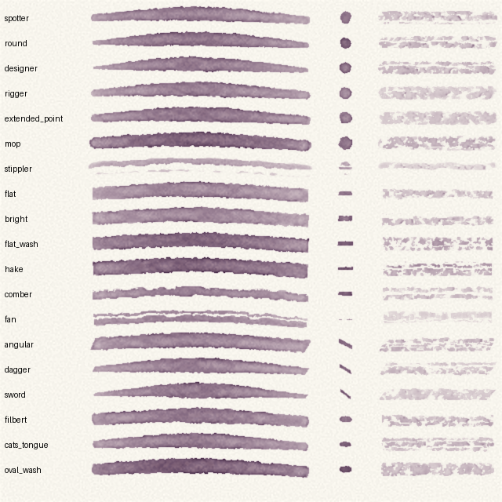
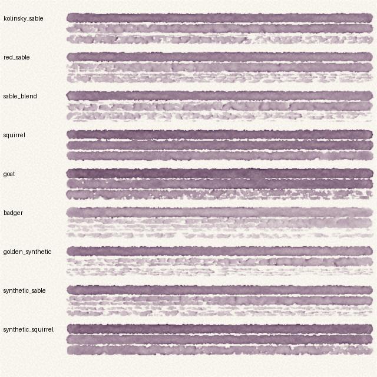
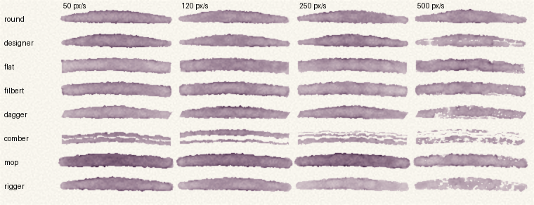

# Brushes

A brush is three things: the **shape** of its head, the **hair** it is made of, and its **size**.

```json
{"action": "load", "brush": "filbert", "hair": "squirrel", "size": 10, "pigments": {"cobalt_blue": 0.6}, "water": 1.0}
```

`hair` may be left out, in which case the head is made of the hair usual for its shape. `size` is the radius of the head in pixels at full pressure; it is not a maker's size number.

The shapes and hairs follow the watercolour ranges of [Rosemary & Co](https://www.rosemaryandco.com/watercolour-brushes), whose descriptions give the order of each property. The numbers behind them are estimates, not measurements.



## Shapes

| Shape | Head | Usual hair | What it is for |
|---|---|---|---|
| `spotter` | round, short | red sable | Small precise touches; holds little, stays where it is put. |
| `round` | round, pointed | red sable | Most work. Swells from a point to its full width with pressure. |
| `designer` | round, long and slim | red sable | Drawing and long expressive lines; the widest range from point to belly. |
| `rigger` | round, very long and thin | red sable | Lines: rigging, branches, grasses. Holds a long line's worth of paint. |
| `extended_point` | round, a fine point on a large reservoir | red sable | Long fine lines without reloading. |
| `mop` | round, full and soft | squirrel | Large soft washes and wetting the paper. |
| `stippler` | round, short and stiff, hairs apart | badger | Broken texture: foliage, stone. |
| `flat` | flat, square end (a one-stroke) | red sable | Bands, planes and architectural strokes with square ends. |
| `bright` | flat, short | red sable | Short controlled planes; scrubs more, holds less. |
| `flat_wash` | flat, wide and soft | squirrel | Broad even washes. |
| `hake` | flat, wide, thin | goat | Background washes and wet-in-wet. |
| `comber` | flat, hairs of uneven length | red sable | Grasses, fur, feathers: several fine lines in one stroke. |
| `fan` | flat, thin, spread | red sable | Sparse streaks; softening. |
| `angular` | flat, end cut at an angle | red sable | Strokes that start and finish on a slant; tight corners. |
| `dagger` | flat, slanted, tapering | sable blend | From a fine line to a broad stroke by pressure. |
| `sword` | flat, long slanted point | Kolinsky sable | Lining with a continuous flow; the widest change of width. |
| `filbert` | flat, rounded end | red sable | Petal and leaf marks; edges that do not show a corner. |
| `cats_tongue` | flat, rounded end drawn to a point | red sable | As a filbert, with a point for detail. |
| `oval_wash` | flat, rounded, large and soft | squirrel | Washes with a soft rounded edge. |

## Hairs



| Hair | Holds | Point | Spring | Character |
|---|---|---|---|---|
| `kolinsky_sable` | most of the sables | finest | strong | The reference watercolour hair. |
| `red_sable` | standard | fine | good | The baseline every other hair is measured against here. |
| `sable_blend` | a little less | good | good | Sable with nylon or ox ear; firmer, parts sooner. |
| `squirrel` | more than twice a sable | fine when wet | almost none | Very soft; lays a great deal of water and leaves a soft edge. |
| `goat` | nearly twice a sable | none | almost none | Soft and absorbent, for washes; will not hold a point. |
| `badger` | little | none | moderate | Stiff; breaks a mark up and disturbs paint beneath it. |
| `golden_synthetic` | least | good | strongest | Firm and springy; releases quickly, runs dry and streaks soonest. |
| `synthetic_sable` | slightly less than sable | fine | good | Made to behave as sable. |
| `synthetic_squirrel` | nearly twice a sable | fine when wet | little | Made to behave as squirrel. |

## Speed



A slow stroke leaves more paint than a fast one. At high speed, thin, long or gapped heads break up first; broad full heads stay solid until they also run dry.

## How the maker's ranges map onto these

| Maker's range | Hair here |
|---|---|
| Pure Kolinsky Sable (Series 8, 11, 22, 33, 44, 52, 55, 56, 60, 66, 323, 331, 332, 363, 441, 731) | `kolinsky_sable` |
| Pure Red Sable and Pure Sable (Series 77, 78, 79, 81, 88, 90, 91, 92, 93, 95, 96, 99, 101, 7320, 7350) | `red_sable` |
| Red Sable Blend (Series 401, 402, 721, 767 to 772) | `sable_blend` |
| Pure Squirrel (Series 38 to 43, 48, and the squirrel mops) | `squirrel` |
| Goat Hair Hakes and Mops (Series 106 to 109, 788, 882, 888, Mundy Mops) | `goat` |
| Badger Hair (Series 27, 37, 1580, 1582) | `badger` |
| Golden Synthetic (Series 221 to 241, 301 to 318, 344, 2230 to 2250) | `golden_synthetic` |
| Red Dot Collection | `synthetic_sable` |
| Sienna, Candidus | `synthetic_squirrel` |
| Snowdrop | `synthetic_sable` (assumed; the page does not say which hair it imitates) |

| Maker's name for the head | Shape here |
|---|---|
| Pointed round, round | `round` |
| Designer | `designer` |
| Spotter, micro, miniature, stubby round | `spotter` |
| Rigger, half rigger, longer rigger, mini rigger | `rigger` |
| Extended point, needle point | `extended_point` |
| Mop | `mop` |
| Deerfoot stippler, flat stippler, foliage and tree brushes | `stippler` |
| One stroke, long flat, lettering | `flat` |
| Short flat, bright, beaver tail, stubby flat | `bright` |
| Flat wash, large background wash | `flat_wash` |
| Hake | `hake` |
| Comber, rake | `comber` |
| Fan, feathered fan | `fan` |
| Angular, side loader, angled hake | `angular` |
| Dagger | `dagger` |
| Swordliner, sword | `sword` |
| Filbert, domed filbert, almond filbert | `filbert` |
| Cat's tongue, long pointed filbert | `cats_tongue` |
| Oval wash, oval mop, pointed oval wash | `oval_wash` |

## Not modelled

- **Handles and packaging:** triangular handles, travel and pocket brushes, and sets use heads already listed.
- **Japanese and sumi brushes**, the rotary tree brush, the smooshing brush and the gilder's tip.
- **The eradicator**, a stiff brush for lifting dried paint; use `blot` on wet paint instead.
- **Softeners and blenders used dry** to feather wet paint. A clean damp brush run along an edge does that job here.
- **Twist.** A flat head always meets the paper square to the direction it travels, so the chisel edge cannot yet be turned during a stroke.
